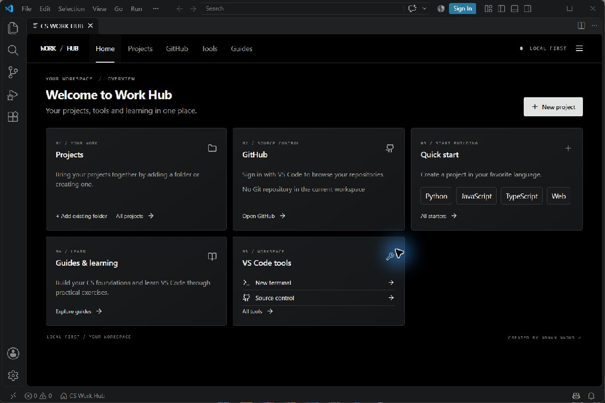
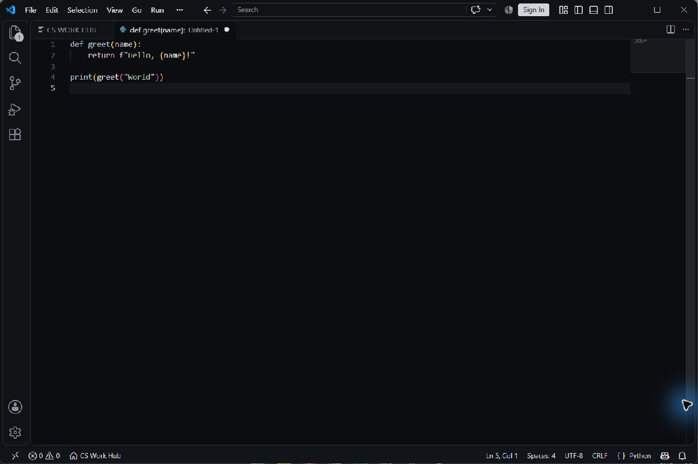

# CS Work Hub

A local-first project dashboard and project creator for desktop Visual Studio Code. Register existing folders, create small starter projects, browse files, open editor tools, and explore programming guides.

Created by [Adnan Naous](https://linktr.ee/VC351).

## Installation

On Windows, [download the latest setup ZIP](https://github.com/AdnanNaous/cs-work-hub-downloads/releases/latest), extract all files, and run `Install-CS-Work-Hub.cmd`. Choose the dashboard alone or the optional Developer Pack. Alternatively, use **Extensions: Install from VSIX...** in VS Code to install the main VSIX. VS Code desktop 1.90 or newer is required; the prebuilt extension does not require Node.js.

Open **CS WORK HUB: Open Dashboard** from the VS Code Command Palette. The optional **CS Work Hub Monochrome** theme is selected separately via **Preferences: Color Theme**; installation does not change your current theme.

The optional Developer Pack requests GitHub Pull Requests, Microsoft Python and the Java Extension Pack, which can install additional extensions and require internet access. It does not install language runtimes, compilers or Git. Automatic pack dependency resolution requires the main extension to be available in the Marketplace.

## Data and limitations

Work Hub stores data locally. Back up your actual project folders separately. Its backup export covers tasks, notes and learning progress, not project references; notes and tasks are retained for import/export but are not shown as dashboard pages. Installing the current extension does not automatically migrate data from the older preview. GitHub sign-in uses VS Code authentication and requests the write-capable `repo` scope to read repository information; the extension does not sync or publish repositories. Guide resources are external and may change.

## License and security

Original CS Work Hub code is distributed under the [proprietary license](LICENSE); third-party components retain the licenses in [THIRD-PARTY-NOTICES.md](THIRD-PARTY-NOTICES.md). Earlier MIT-licensed copies retain previously granted rights. This downloads catalog does not contain private development history. See [SECURITY.md](SECURITY.md) for reporting information.

## Release verification

[Verify release checksums and understand publication boundaries](RELEASE-INTEGRITY.md).
